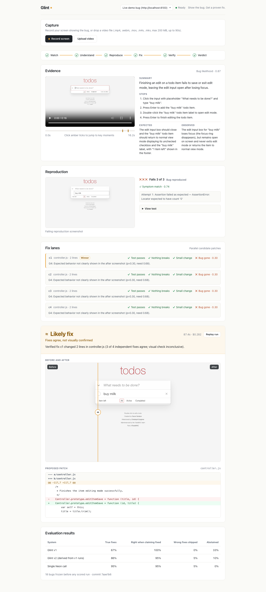

# Glint

Glint takes a screen recording of a bug in a web app and returns a code fix only when it can show evidence
that the fix works; otherwise it says it could not, and hands back a failing test.

**Show Glint the bug. It tells you which fixes it can prove.**

**Demo video:** [1-minute walkthrough](docs/demo/glint_submission_1min.mp4)



*The verdict screen for one real run (`docs/examples/fixes-agree_m001`). "Likely fix" means the fixes agreed
but the visual check did not confirm them.*

## How it works

1. **Watch.** Gemini 4 Neon watches the recording, reads the app's source code, and writes down what the
   user did, what should have happened, and what happened instead.
2. **Reproduce.** Gemini 4 Hydrogen writes an automated browser test of those steps. Glint keeps the test
   only if it fails on the buggy app 3 times out of 3, and Gemini Decision 1 agrees the failure looks like
   the bug in the video.
3. **Fix.** Hydrogen writes 4 candidate fixes in parallel.
4. **Check.** Each fix must make the test pass, survive 30 random clicks and keystrokes with no errors, and
   stay small (at most 2 files and 40 changed lines). Then Decision 1 compares a before and an after
   screenshot. Decision 1 is a model that answers yes/no questions with a probability.
5. **Verdict.** A fix that passes is returned with its evidence. If none passes, Glint returns the failing
   test and says it has no verified fix.

## Does it work?

Scored once, on 18 test bugs that were frozen before the run. The table is copied from
[RESULTS.md](RESULTS.md).

| System | Bug runs | True-fix rate | Precision when claiming fixed | Wrong-fix rate | Abstain rate | False fixes on clean videos | Median latency (s) | Mean cost (USD) |
|---|---|---|---|---|---|---|---|---|
| Glint v1 | 21 | 66.7% (14/21) | 100.0% (14/14) | 0.0% (0/21) | 33.3% | 0 of 1 | 56.9 | 0.2358 |
| Glint v2 (derived from v1 runs) | 21 | 85.7% (18/21) | 94.7% (18/19) | 4.8% (1/21) | 9.5% | 0 of 1 | 56.9 | 0.2358 |
| Single Neon call | 21 | 95.2% (20/21) | 95.2% (20/21) | 4.8% (1/21) | 0.0% | 0 of 1 | 27.7 | 0.0907 |

"Single Neon call" is the baseline: one model call that gets the video and the code and returns a fix, with
no checks. "Derived" means the saved v1 runs were recounted under the v2 rule with no model called again;
newly claimed fixes were scored the same way.

- **What Glint is better at:** Glint v1 was right on all 14 fixes it claimed, and shipped no wrong fix; the
  single call shipped one.
- **What the single call is better at:** it fixed more bugs (95.2%, against 66.7% for v1 and 85.7% for v2),
  at about 2.6x lower cost and in about half the time.
- **What we changed after seeing failures:** in 5 of v1's 7 misses the fix was correct and the screenshot
  check rejected it, so v2 also accepts a fix when at least 3 candidates are identical. v2 was chosen after
  seeing the v1 results; it raised the fix rate and introduced one wrong fix (m013).
- **Which predictions we got wrong:** 3 of 6. The single call's wrong-fix rate was 4.8%, not at least 10%;
  it changed no code on the one clean video, not on all of them; and Glint did no worse on phone recordings
  than on screen recordings, on 3 phone videos.

Per-run records: eval/results/test_v1 and eval/results/test_v2_derived.

## Try it

You need Python 3.12, `ffmpeg` on your PATH, Chromium (installed through Playwright below), and a Gemini
API key.

```
git clone https://github.com/nihantthnaidu007/glint.git
cd glint
python3.12 -m venv .venv
source .venv/bin/activate
pip install -e ".[dev]"
playwright install chromium
cp .env.example .env
```

Put your key after `GEMINI_API_KEY=` in `.env`. Then check that the models answer and the tests pass:

```
python scripts/smoke.py
pytest -q tests
```

Run Glint on one recorded bug from the command line (about a minute, about $0.25):

```
python -m glint.pipeline --video eval/corpus/todomvc/m004/video_r0.webm --app eval/corpus/todomvc/m004/app --app-id todomvc
```

To record a bug yourself:

1. Start Glint: `uvicorn glint.server:app --port 8000`, then open http://localhost:8000.
2. In a second terminal, make a fresh bug: `python scripts/make_live_bug.py --seed 7`. Any whole number
   works as the seed. The broken app is served at http://localhost:8100.
3. In Glint, choose "Live demo bug", press "Record screen", and share the tab with the broken app. Use the
   app until something goes wrong, then stop the recording. You can also upload a video file.
4. `python scripts/make_live_bug.py --reveal` prints what the bug was.

## Reproduce the results

```
GLINT_MAX_CONCURRENCY=16 python -m eval.run_eval --split test --systems glint,baseline --rungs r0,r3 --include-clean --tag v1 --concurrency 4
python -m eval.derive_v2 --split test
python -m eval.report
```

- **Runtime:** our scored run took about 22 minutes on one laptop (about 9 minutes of model runs, then about
  13 minutes of scoring). The second command took about 4 minutes and calls no model.
- **API cost:** roughly $7 for the scored run (22 Glint runs at about $0.24 and 22 single calls at about
  $0.09). Decision 1 calls are counted at $0 because we did not know the price, so the real cost is higher.
- **What you get:** `RESULTS.md` and `eval/results/summary.json`. Model output varies between runs, so your
  numbers will not match ours exactly.
- **Our evidence:** the record of every scored run is in `eval/results/test_v1` and
  `eval/results/test_v2_derived`. Three complete example runs (video, bug report, generated test, fixes,
  screenshots) are in `docs/examples`.

How the test was built: 28 bugs were generated by a program that changes one line of the app; 3 were
excluded before scoring, leaving 7 for tuning and 18 for the test. A fix counts as correct only if 200 random
click-and-type sequences behave the same on the fixed app as on the original app, which Glint never sees.
That scoring check was itself tested first: 37 of 37 controls passed. Details: `eval/FROZEN.md`,
`eval/PREDICTIONS.md`, `eval/corpus/EXCLUSIONS.md`, `eval/CHANGES_AFTER_V1.md`.

## Limitations

- 18 mutants of one app (TodoMVC). Every bug is a single synthetic mutation, so these numbers say nothing
  about other apps or about bugs that span several files.
- TRUE_FIX means the differential fuzzer found no behavior difference from the unmutated app. That is strong
  evidence, not a proof of equivalence.
- A clean-video false fix counts every claimed fix on a video without a bug, including patches that do not
  change behavior.
- Latency is wall time measured while several runs share one machine and one API quota.
- With 18 mutants each run moves a rate by 6 points or more.
- Decision model calls are priced at $0 because the price is unknown, so Glint's cost is a lower bound.
- One small app. We did not test larger codebases.
- Single-line bugs only.
- No sandbox: generated tests and patched apps run on your machine.
- Thresholds were tuned on 7 dev bugs.
- The visual check fails when a fix is not visible in the final screen. That caused most of v1's misses.
- Only 1 clean video and 3 phone videos were scored, so those two results rest on very little data.
- The v1 numbers were produced before a bug fix in one check (it could click links that leave the app). The
  bug shows once in the saved v1 runs and did not change that run's verdict.

## Built at the hackathon

Built at the Gemini 4 NYC Hackathon on Nov 21, 2026. All code in this repository is new work written that
day; see the [commit history](https://github.com/nihantthnaidu007/glint/commits/main).

`apps/todomvc` is third-party code: the TodoMVC plain JavaScript example, MIT license (see
`apps/todomvc/LICENSE`). It is used only as a test subject. We did not write it.

## Repo map

| Path | What it holds |
|---|---|
| `glint/` | The product: pipeline, model calls, checks, web server. |
| `web/` | The browser UI, plain HTML, CSS and JavaScript. |
| `eval/` | Bug generator, recorder, scoring check, eval runner, report, the test bugs and their videos. |
| `docs/examples/` | Three complete example runs. |
| `RESULTS.md` | The full generated results, including every failure and every prediction. |
| `docs/` | The build plan and interface contracts we worked from, the demo video. |
| `apps/todomvc/` | The third-party app used as the test subject. |
